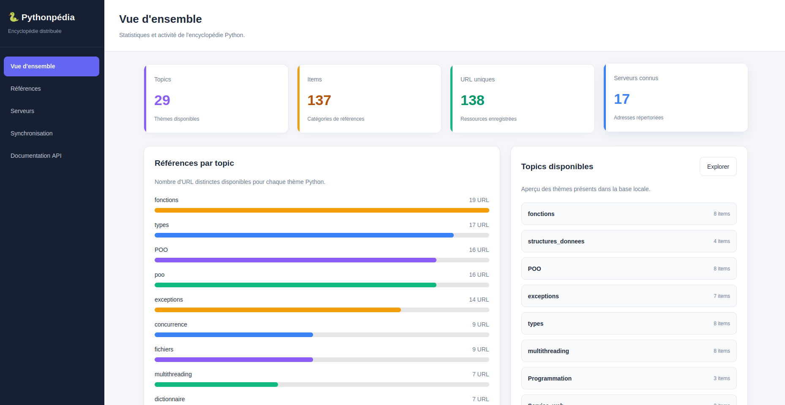
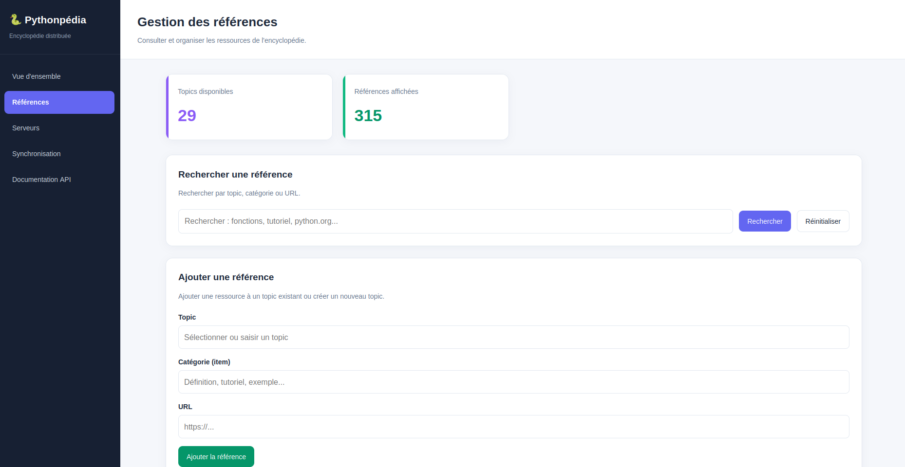
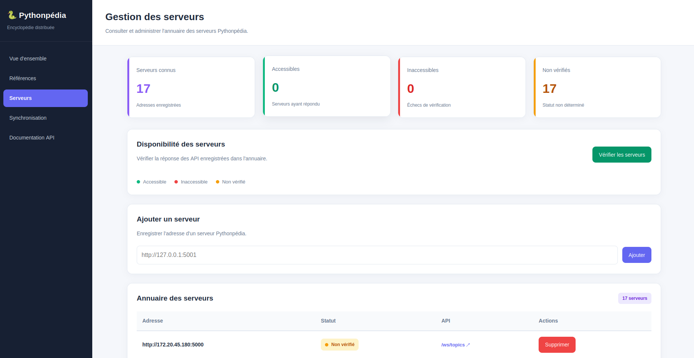
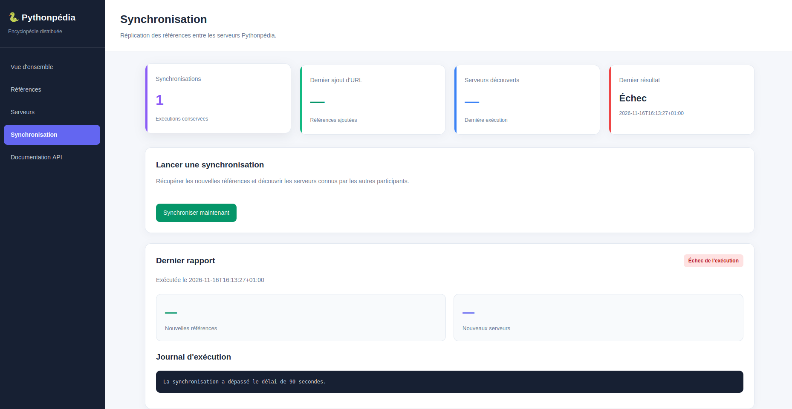

# Pythonpédia

**Encyclopédie distribuée de ressources sur Python**, développée avec Flask. Chaque instance conserve un catalogue local de références et peut récupérer celles d'autres serveurs grâce à une API REST et à un mécanisme de synchronisation.

Projet réalisé dans le cadre d'un enseignement d'informatique pour la big data, puis enrichi avec une interface de gestion, des tests automatisés et une démonstration multi-serveurs.

## Fonctionnalités

- **Catalogue de références** organisé par thème (*topic*), catégorie (*item*) et URL.
- **API REST publique en lecture** pour consulter les thèmes, leur contenu et l'annuaire des serveurs.
- **Tableau de bord** : indicateurs, répartition des références par thème et navigation entre les sections.
- **Gestion locale des références** : recherche, ajout et suppression.
- **Gestion locale des serveurs** : ajout, suppression et vérification de disponibilité sur demande.
- **Synchronisation distribuée** : import des références manquantes, prévention des doublons et découverte de serveurs par leurs annuaires.
- **Historique des synchronisations** : résultat, journal d'exécution et nombre de références et de serveurs ajoutés.
- **Tests automatisés** avec `pytest`, notamment pour l'API, la fusion des données et les accès concurrents.

Les actions de gestion sont réservées aux requêtes locales et protégées par des jetons CSRF. Le serveur de développement n'est **pas destiné à être exposé tel quel sur Internet**.

## Technologies

- Python 3, Flask et Jinja2
- HTML et CSS
- Requests pour les échanges HTTP
- JSON pour le stockage local
- `fcntl.flock` pour la coordination des écritures entre processus sous Linux
- `pytest` pour les tests

## Aperçu de l'application

Pythonpédia dispose d'une interface web permettant de consulter les
références Python et de gérer les différents serveurs de l'encyclopédie.

### Vue d'ensemble

Le tableau de bord présente les principales statistiques de
l'application : topics, items, références et serveurs connus.



### Gestion des références

Cette interface permet de rechercher des ressources Python,
d'ajouter de nouvelles références et de supprimer celles
qui ne sont plus nécessaires.



### Gestion des serveurs

L'annuaire répertorie les serveurs Pythonpédia et permet
de vérifier leur disponibilité.



### Synchronisation distribuée

Cette page permet de lancer la réplication des données,
de consulter les résultats et de suivre l'historique
des synchronisations.




## Installation (Ubuntu/Linux)

Prérequis : Python 3, `venv` et Git.

```bash
git clone https://github.com/jcgeorges/pythonpedia.git
cd pythonpedia
python3 -m venv .venv
source .venv/bin/activate
python -m pip install -r requirements.txt
```

Démarrer le serveur :

```bash
python app.py
```

Adresses utiles :

| Interface | Adresse |
| --- | --- |
| Documentation | `http://127.0.0.1:5000/` |
| Vue d'ensemble | `http://127.0.0.1:5000/dashboard` |
| Références | `http://127.0.0.1:5000/dashboard/references` |
| Serveurs | `http://127.0.0.1:5000/dashboard/serveurs` |
| Synchronisation | `http://127.0.0.1:5000/dashboard/synchronisation` |

Pour choisir un autre port :

```bash
PYTHONPEDIA_PORT=5001 python app.py
```

Le serveur écoute par défaut sur `127.0.0.1`, afin de limiter l'accès à l'ordinateur local.

## API REST

| Méthode | Endpoint | Description |
| --- | --- | --- |
| `GET` | `/ws/topics` | Liste des thèmes disponibles |
| `GET` | `/ws/topic/<topic>` | Catégories et URL du thème demandé |
| `GET` | `/ws/annuaire` | Adresses des serveurs connus |

Exemples :

```bash
curl http://127.0.0.1:5000/ws/topics
curl http://127.0.0.1:5000/ws/topic/fonctions
curl http://127.0.0.1:5000/ws/annuaire
```

La structure du catalogue est la suivante :

```json
{
  "fonctions": {
    "definition": ["https://docs.python.org/fr/3/tutorial/controlflow.html"],
    "tutoriel": ["https://docs.python.org/fr/3/tutorial/controlflow.html#defining-functions"]
  }
}
```

*Exemple illustratif ; le contenu réel dépend de la base locale.*

## Synchronisation distribuée

Chaque serveur possède ses propres fichiers `data/topics.json` et `data/serveurs.json`.

1. Le serveur lit la liste des pairs connus.
2. Il récupère leur liste de thèmes (`/ws/topics`) et les références associées (`/ws/topic/<topic>`).
3. Il fusionne les URL absentes avec son catalogue local sans supprimer les références existantes.
4. Il récupère leur annuaire (`/ws/annuaire`) pour découvrir d'autres serveurs.
5. Les serveurs découverts peuvent être contactés lors de l'exécution suivante.

Les opérations réseau sont effectuées hors du verrou d'écriture. La fusion locale relit les données récentes sous verrou pour limiter les pertes de modifications concurrentes.

La synchronisation peut être lancée depuis l'interface locale ou en ligne de commande :

```bash
python -m services.synchronisation
```

## Démonstration avec trois serveurs sur un seul ordinateur

Le script `scripts/preparer_demo.py` prépare trois instances indépendantes dans `demo/`, chacune avec son propre jeu de données et son annuaire. À exécuter **une seule fois** : il refuse d'écraser un dossier `demo/` existant.

```bash
python scripts/preparer_demo.py
```

Si le script de préparation n'a pas encore été mis à jour pour copier les fichiers statiques, ajoute les styles actuels aux trois instances :

```bash
for serveur in serveur_a serveur_b serveur_c; do
  cp -r static "demo/$serveur/static"
done
```

Ouvrir trois terminaux à la racine du projet (avec l'environnement virtuel activé) :

**Terminal A :**

```bash
PYTHONPEDIA_PORT=5000 PYTHONPEDIA_ALLOW_LOOPBACK=1 python demo/serveur_a/app.py
```

**Terminal B :**

```bash
PYTHONPEDIA_PORT=5001 PYTHONPEDIA_ALLOW_LOOPBACK=1 python demo/serveur_b/app.py
```

**Terminal C :**

```bash
PYTHONPEDIA_PORT=5002 PYTHONPEDIA_ALLOW_LOOPBACK=1 python demo/serveur_c/app.py
```

Pour déclencher la synchronisation du serveur A, depuis un quatrième terminal :

```bash
cd demo/serveur_a
PYTHONPEDIA_ALLOW_LOOPBACK=1 python -m services.synchronisation
```

Relancer la commande permet notamment d'interroger les serveurs nouvellement découverts. Les données de `demo/` sont séparées de celles de l'application principale.

> Le mode `PYTHONPEDIA_ALLOW_LOOPBACK=1` sert à tester les communications entre instances locales. Ne pas l'utiliser pour exposer un service à des réseaux non fiables.

## Tests

Avec l'environnement virtuel activé, depuis la racine du dépôt :

```bash
python -m pytest -v
```

Les tests couvrent notamment la lecture et l'écriture JSON, les routes API, la fusion sans doublons, les protections des routes de gestion et les écritures concurrentes.

## Organisation du projet

```text
pythonpedia/
├── app.py                        # Application Flask et routes HTTP
├── data/                         # Catalogue et annuaire locaux (JSON)
├── services/
│   ├── database.py               # Lecture et écriture JSON
│   ├── synchronisation.py        # Récupération et fusion des références
│   ├── historique.py             # Historique des synchronisations
│   └── verrou.py                 # Verrou interprocessus sous Linux
├── templates/                    # Pages HTML / Jinja2
├── static/css/style.css          # Mise en forme du tableau de bord
├── scripts/preparer_demo.py      # Préparation des instances locales
├── tests/                        # Tests automatisés
└── requirements.txt
```

## Limites et pistes d'évolution

- Le stockage JSON reste adapté à un projet pédagogique, mais une base SQLite serait plus pertinente pour des volumes importants et des transactions multi-fichiers.
- La disponibilité des serveurs est vérifiée à la demande ; il ne s'agit pas d'une supervision continue.
- Le verrouillage coordonne les processus qui utilisent les mêmes fichiers locaux et le même verrou. Il ne constitue pas une transaction distribuée entre machines.
- Avant tout déploiement public, il faudrait renforcer l'authentification, contrôler les destinations des requêtes sortantes et utiliser un serveur WSGI adapté.

## Auteur

**Jean Constantin GEORGES** — Projet universitaire en data science, Université d'Angers.
